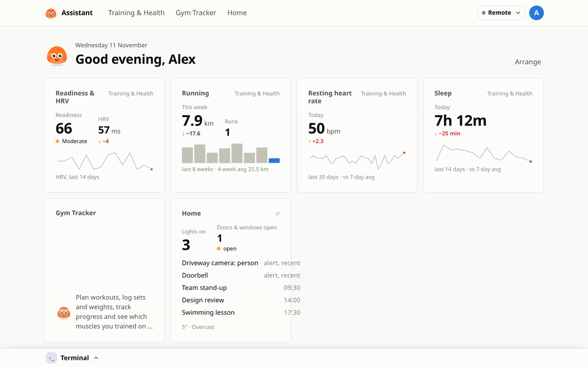
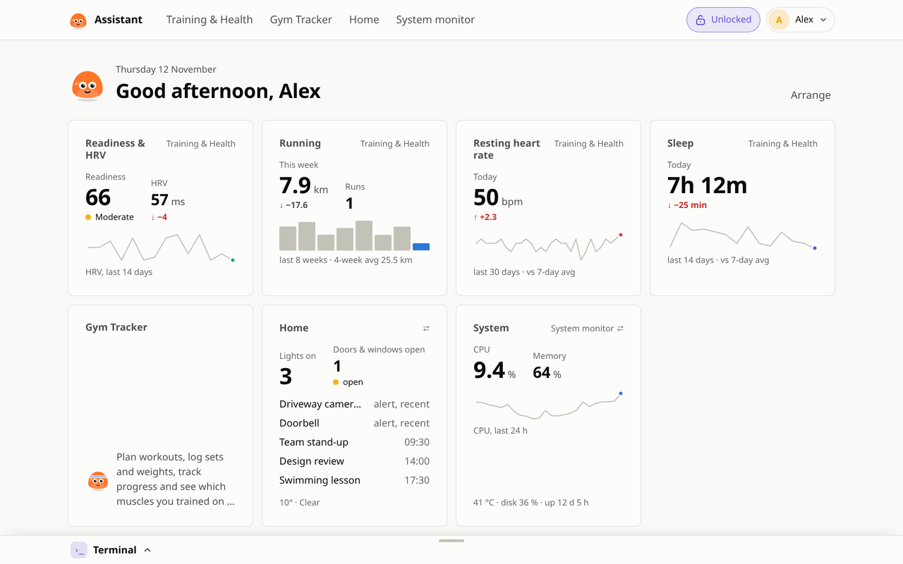
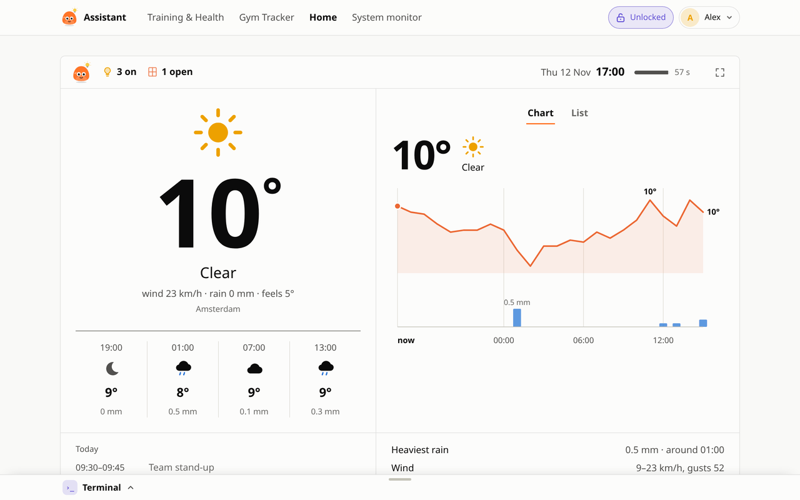
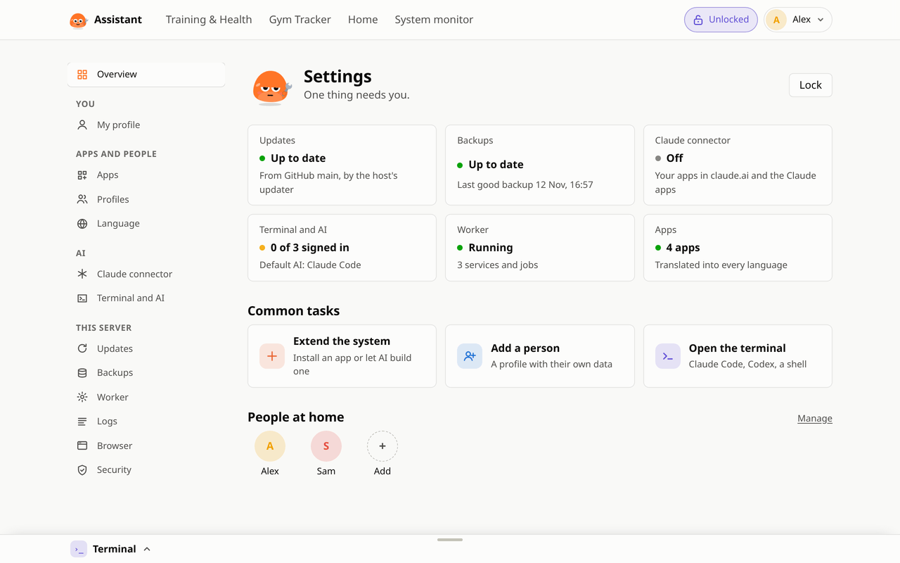
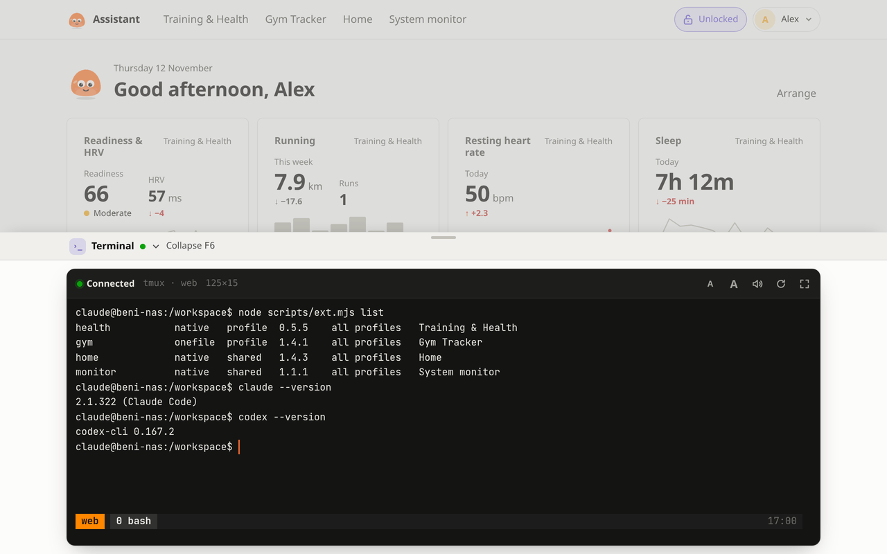
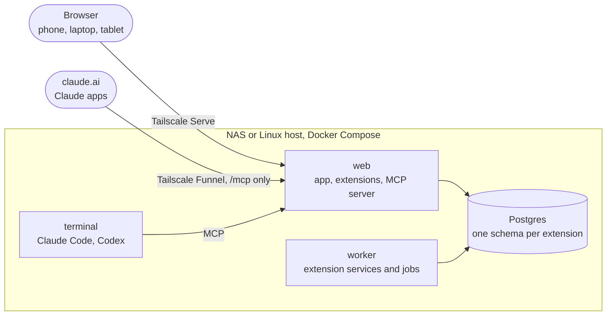

<div align="center">


# Beni Assistant

A self-hosted web app. Apps are added as extensions.
Claude uses the extensions' data through an MCP server: from claude.ai, or from Claude Code and Codex in the app's terminal.
Runs on Linux or a Synology NAS with Docker Compose. You reach it over your Tailscale network with HTTPS.

[Install](#quick-start) · [Screenshots](#screenshots) · [Extensions](https://github.com/b-niamin/assistant-extensions) · [Docs](#docs)



</div>

## What it does

<table>
  <tr>
    <td width="33%" valign="top"><h3>Runs on your machine</h3>One Docker Compose stack on a Synology NAS or any Linux host with Docker. The data is in Postgres on that host.</td>
    <td width="33%" valign="top"><h3>Extensions</h3>Each app is an extension with its own page, dashboard tiles and database schema. Install one from System settings or ask Claude to write one.</td>
    <td width="33%" valign="top"><h3>MCP for Claude</h3>Every extension adds its tools to one MCP server. Add it to claude.ai as a connector, or use it from Claude Code and Codex in the app's terminal.</td>
  </tr>
  <tr>
    <td valign="top"><h3>Profiles</h3>One app password for the whole app. Each profile has its own data.</td>
    <td valign="top"><h3>Tailnet only</h3>The app listens on 127.0.0.1 behind Tailscale Serve. Only the MCP server can be published, through Tailscale Funnel, with OAuth sign-in.</td>
    <td valign="top"><h3>Updates</h3>An updater pulls GitHub <code>main</code> and rebuilds only the services whose files changed, on a schedule or from System settings.</td>
  </tr>
</table>

## Quick start

On a Synology NAS or any Linux host with Docker and Compose:

```sh
curl -fsSL https://raw.githubusercontent.com/b-niamin/assistant/main/install.sh -o install.sh
less install.sh        # it runs as root: read what it does first
sudo sh install.sh
```

(`curl -fsSL .../install.sh | sudo sh` does the same in one line, without the reading.)

It asks nothing: it picks a folder and free ports, starts the stack and prints an address and a setup code.

1. Open the printed address + `/setup`, enter the setup code and follow the wizard: password, profile, apps, updates and Claude.
2. Check the install with `sudo ./beni.sh doctor`.

Synology steps, installer options and `beni.sh` commands: [docs/install.md](docs/install.md).

## Screenshots

<table>
  <tr>
    <td width="50%"><p align="center"><b>Dashboard</b>: tiles from the installed extensions</p></td>
    <td width="50%"><p align="center"><b>Home</b>: an extension, Home Assistant data and weather</p></td>
  </tr>
  <tr>
    <td><p align="center"><b>System settings</b>: apps, updates, backups, the worker</p></td>
    <td><p align="center"><b>Terminal</b>: a shell with Claude Code and Codex</p></td>
  </tr>
</table>

<p align="center">Light and dark theme (<a href="docs/screenshots/dashboard-dark.png">dark dashboard</a>). Screenshots use demo data.</p>

## How it works



The core provides login, profiles, the dashboard, System settings, the terminal and the MCP server.
Everything else is an extension, either from [assistant-extensions](https://github.com/b-niamin/assistant-extensions) or
written by Claude in your instance. Details: [architecture spec](specs/000-architecture.md).

## Docs

- [Extensions repo](https://github.com/b-niamin/assistant-extensions): ready-made extensions
- [Install and run](docs/install.md): installer, Synology steps, `beni.sh`, development
- [Architecture](specs/000-architecture.md), [extensions](specs/002-extensions.md), [MCP and the Claude connector](specs/005-claude-tools.md), [security](specs/004-security.md), [all specs](specs)
- [AGENTS.md](AGENTS.md): rules for people and AI agents working in this repo
