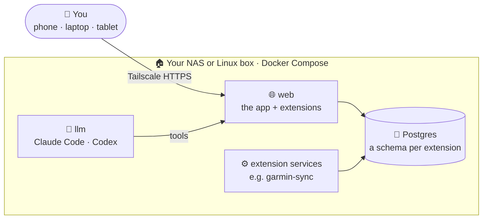

<div align="center">


# Beni Assistant

### Your private assistant, self-hosted at home.

A small app for your NAS that grows with extensions, and Claude inside to run them and build new ones.

[Install](#-quick-start) · [Screenshots](#-screenshots) · [Extensions](https://github.com/b-niamin/assistant-extensions) · [Docs](#-learn-more)


</div>

## ✨ What you get

<table>
  <tr>
    <td width="33%" valign="top"><h3>🏠 Yours, at home</h3>One Docker Compose stack on your NAS or Linux box. Your data never leaves your hardware.</td>
    <td width="33%" valign="top"><h3>🧩 Apps as extensions</h3>Training &amp; health, a gym tracker, a home board, or anything you ask for, added from System settings.</td>
    <td width="33%" valign="top"><h3>🤖 Claude inside</h3>Claude Code and Codex live in the stack: they read every app's data and build new extensions on request.</td>
  </tr>
  <tr>
    <td valign="top"><h3>👨‍👩‍👧 One password, many profiles</h3>Each person gets their own data behind one app password. No accounts to manage.</td>
    <td valign="top"><h3>🔒 Private by design</h3>Reached only over your Tailscale tailnet with HTTPS. Nothing open to the internet or the LAN.</td>
    <td valign="top"><h3>🔄 Keeps itself current</h3>Updates from GitHub <code>main</code> on a schedule or with one click in System settings.</td>
  </tr>
</table>

## 🚀 Quick start

On a Synology NAS or any Linux machine with Docker and Compose:

```sh
curl -fsSL https://raw.githubusercontent.com/b-niamin/assistant/main/install.sh | sudo sh
```

1. Answer the questions with Enter (folder, port, extensions, auto-update).
2. Open the printed address + `/setup`, type the setup code, pick a password and your profile.
3. Done. Check the install any time with `sudo ./beni.sh doctor`.

Synology step by step, every installer option and the `beni.sh` commands: [docs/install.md](docs/install.md).

## 📸 Screenshots

<table>
  <tr>
    <td width="50%"><p align="center"><b>Dashboard</b>: tiles from every extension</p></td>
    <td width="50%"><p align="center"><b>Home</b>: an extension on a wall tablet</p></td>
  </tr>
  <tr>
    <td><p align="center"><b>System settings</b>: apps, people, updates</p></td>
    <td><p align="center"><b>Terminal</b>: Claude Code, Codex, a shell</p></td>
  </tr>
</table>

<p align="center">Light and dark (<a href="docs/screenshots/dashboard-dark.png">dark dashboard</a>). All screenshots use demo data.</p>

## 🧭 How it works



The core is a shell: login, profiles, dashboard, System settings, terminal. Everything else is an
extension from [assistant-extensions](https://github.com/b-niamin/assistant-extensions) or one Claude
built for you. The stack updates itself from GitHub `main`. More in the [architecture spec](specs/000-architecture.md).

## 📚 Learn more

- 🧩 **[Extensions repo](https://github.com/b-niamin/assistant-extensions)**: ready-made apps and inspirations to build from
- 🛠️ **[Install and run](docs/install.md)**: installer details, Synology walkthrough, `beni.sh`, development
- 🏗️ **[Architecture](specs/000-architecture.md) · [Extensions](specs/002-extensions.md) · [Security](specs/004-security.md)**: how it is built ([all specs](specs))
- 🤝 **[AGENTS.md](AGENTS.md)**: rules for people and AI agents working in this repo
